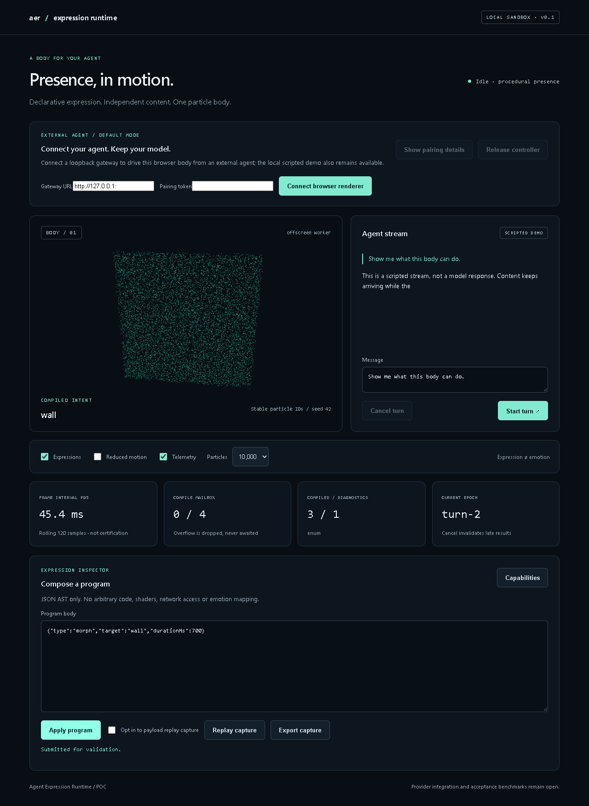

# Agent Expression Runtime

A provider-independent, Windows-first Tauri + TypeScript runtime: a particle body controlled by a bounded, declarative JSON AST. External agents connect through authenticated local HTTP/SSE or the MCP adapter. The engine itself requires no model account, model SDK or API key; the one-command launcher uses your signed-in Codex CLI.



## Browser / multiplexer quick start

In a free Herdr/PowerShell pane at the repository root, run:

```powershell
npm start
```

This builds the runtime, opens and pairs the browser body, and starts a fresh Codex session in that pane with MCP already connected. No clipboard token, environment commands or manual Codex configuration. Exit Codex or close the body window to stop. Requires Node 22.12+, Rust with the platform Tauri build prerequisites, Edge/Chrome and a signed-in Codex CLI. The Node launcher supports Windows, Linux and macOS. See [the one-command guide](docs/browser-and-hosts.md).

## Development entry points

Requires Node.js 22.12+ (or 24), npm, and for desktop Rust stable, Microsoft C++ Build Tools and WebView2.

```sh
npm ci
npm run dev
```

Open the printed local URL. Start a scripted turn, cancel it, submit a JSON program, inspect capabilities, change quality, or opt in to expression replay capture.

```sh
npm run tauri -- dev
```

The desktop app starts a loopback-only gateway and shows pairing details on demand. Follow [external agent integration](docs/integration.md) for the HTTP/MCP protocol. The body works without the conversation demo. The runtime itself never calls a model; `npm start` launches your signed-in Codex CLI as the external agent. The browser conversation demo remains scripted. No paid services are configured by the launcher.

## Validate

```sh
npm test
npm run check:architecture
npm run build
cargo check --locked --manifest-path src-tauri/Cargo.toml
cargo test --locked --manifest-path src-tauri/Cargo.toml
```

Browser smoke test: start `npm run dev`, install Chromium with `npx playwright install chromium`, then `node scripts/browser-smoke.mjs`. `CHROME_PATH` may point to an existing compatible Chromium. The smoke test writes screenshots and a JSON result to `docs/evidence/`.

## What is implemented

- Strict envelope/AST validation, byte-limited UTF-8 JSONL framing and atomic rejection.
- Sequence, parallel, wait, immutable versioned define/call macros, bounded compiler cache and resource checks.
- Monotonic scheduler, property conflict detection, epoch cancellation, stale sequence/TTL admission, bounded append queue, replacement from displayed morph weights and baseline patches.
- Seeded sphere, wall, pin, screw, pyramid, wave and cloud with orbit, turbulence and pulse; color, point size, brightness and dispersion.
- Worker compiler, feature-tested OffscreenCanvas renderer, main-thread fallback, reduced motion and manual particle quality tiers.
- Separate content/expression adapter APIs, bounded/acknowledged Tauri IPC, privacy-conscious counters and explicit opt-in replay.
- Loopback Rust HTTP gateway with ephemeral pairing token, strict Origin/Host policy, single-controller sessions, dedup, admission deadline and bounded SSE feedback.
- TypeScript host helper, minimal MCP stdio tools/resources and versioned agent instruction bundle; external model credentials never enter the runtime.
- GitHub Actions for unit/build/boundary checks and Windows Rust compilation.

## Status and acceptance

This is an initial POC implementation, **not a claim that M1–M3 or performance acceptance are complete**. See [validation](docs/validation.md), [architecture and known limits](docs/architecture.md), and [benchmark procedure](docs/benchmark.md).

First real agent-host selection/demo, token overhead measurement, native visual checks, 20-minute memory soak and target-machine performance acceptance remain open. Direct model API mode is optional and unimplemented. Headless browser tests cannot certify Windows WebView/GPU behavior. The source SRS attachments are deliberately excluded from the public repository.

Product-code license remains undecided. This public repository is a source preview, not a completed OSS licensing release. Dependency licenses and the original generated icon remain separate; no license was silently inherited from another repository.

## Example

```json
{"v":1,"epoch":"runtime-assigned","seq":1,"kind":"program","track":"body","policy":"replace","body":{"type":"parallel","children":[{"type":"morph","target":"wall","durationMs":900},{"type":"flow","field":"orbit","strength":0.35,"durationMs":1800}]}}
```

Epoch and sequence must be assigned by the application adapter, not trusted from a model. Expressions are selected behavior, not evidence of internal emotion. Input can never supply JavaScript, Rust, shader code, I/O or recursion.
