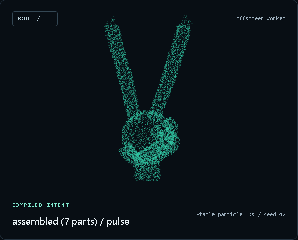

# Fisch

A provider-independent, Windows-first Tauri + TypeScript runtime: a particle body controlled by a bounded, declarative JSON AST. External agents connect through authenticated local HTTP/SSE or the MCP adapter. The expression engine and status reflexes require no model account, model SDK or API key; the pane launcher attaches to your existing Codex or Claude session.


## Fisch Live POC

Run `node bin/fisch.mjs live` from a Herdr shell beside a Codex pane (or choose the source with `live --agent <pane-id>`). Live opens a local camera/debug + particle WebGL browser workspace and a dedicated Codex pane with transient MCP settings, preserving the old session. Camera starts off; real pixels stay local. Codex uses observe/express and synthetic-only look; there is no secondary planner. The optional output-rhythm proxy is experimental/off by default. Voice and human perception remain unverified. See [Live setup, privacy, controls and acceptance](docs/fisch-live.md) and [the implementation plan](docs/fisch-live-plan.md). A built native gateway, installed dependencies and existing Codex login are required; the current machine has been prepared.

## Herdr quick start

Link the checkout once with `npm link`. Keep Codex or Claude running in one Herdr pane. In the neighboring free pane, run:

```sh
fisch run
```

Fisch displays its particle body inside that pane, discovers the existing agent in the same workspace, and subscribes to its lifecycle status events. Activity automatically drives the expression engine; the agent receives no extra prompt and calls no Fisch tool. It opens no browser or new interactive agent; contextual planning uses a separate noninteractive provider process. Requires Node 22.12+ and Herdr. Missing npm dependencies are installed automatically.

A background Codex/Claude process creates free-form expressions in response to actual user-message hooks, using its existing CLI login. Local attention stays visible while inference runs. A real interaction can also prepare model-authored idle scenes: the body later changes full form and may show a short caption inside its pane, with no model calls during idle, notifications or sounds. Scenes live in memory; a fresh launch without a prepared scene keeps the fallback body. Hook installation is opt-in: run `fisch hooks install codex` or `fisch hooks install claude` once; remove it with `fisch hooks uninstall`. Launch never edits provider or Herdr settings. **Codex also requires trusting the new hooks in `/hooks`.** The pane header and `fisch status` report whether real events arrived. API inference is optional. See [planner scope](docs/expression-planner.md) and [current behavior, research and limits](docs/related-work.md#10-cập-nhật-braille-theo-thời-gian-và-idle-scene-tự-do). Set `FISCH_PLANNER_BACKEND=off` to keep local reactions without inference.

The installed Herdr client currently uses colored Braille particles; inline RGB is selected when Herdr supplies its graphics API and cell dimensions. Adaptive Braille uses density sampling, smoothed tone mapping, fixed Bayer dithering and hysteresis; set `FISCH_BRAILLE_STYLE=peak` in the launching environment for the previous denser peak-area glyph style. `fisch status` exposes the active rendering style and prepared idle scenes. Terminal rendering still has lower visual fidelity than the browser reference renderer. See [pane workflow and controls](docs/multiplexer.md).

## Reconfigurable swarm

The model can now compose curve tubes, ellipsoid shells and surface patches with stable part IDs and independent motion through `assemble`. Hands, faces and creatures are geometry it constructs, rather than hard-coded shape names. See [the geometry language and limits](docs/swarm-geometry.md).



## Development entry points

Requires Node.js 22.12+ (or 24), npm, Rust stable and the platform Tauri prerequisites. Windows desktop builds need Microsoft C++ Build Tools and WebView2; Linux builds need GTK/WebKit development packages.

```sh
npm ci
npm run dev
```

Open the printed local URL. Start a scripted turn, cancel it, submit a JSON program, inspect capabilities, change quality, or opt in to expression replay capture.

```sh
npm run tauri -- dev
```

The desktop app starts a loopback-only gateway and shows pairing details on demand. Follow [external agent integration](docs/integration.md) for the HTTP/MCP protocol. The body works without the conversation demo. The runtime itself never calls a model; `fisch run` attaches to the existing agent through a private local socket. The browser conversation demo remains scripted. No paid services are configured by the launcher.

## Validate

```sh
npm test
npm run check:architecture
npm run build
cargo check --locked --manifest-path src-tauri/Cargo.toml
cargo test --locked --manifest-path src-tauri/Cargo.toml
```

Browser smoke test: start `npm run dev`, install Chromium with `npx playwright install chromium`, then `node scripts/browser-smoke.mjs`. `CHROME_PATH` may point to an existing compatible Chromium. The smoke test writes screenshots and a JSON result to `docs/evidence/`.

## What is implemented

- Strict envelope/AST validation, byte-limited UTF-8 JSONL framing and atomic rejection.
- Sequence, parallel, wait, immutable versioned define/call macros, bounded compiler cache and resource checks.
- Monotonic scheduler, property conflict detection, epoch cancellation, stale sequence/TTL admission, bounded append queue, replacement from displayed morph weights and baseline patches.
- Seeded sphere, wall, pin, screw, pyramid, wave and cloud with orbit, turbulence and pulse; color, point size, brightness and dispersion.
- Worker compiler, feature-tested OffscreenCanvas renderer, main-thread fallback, reduced motion and manual particle quality tiers.
- Separate content/expression adapter APIs, bounded/acknowledged Tauri IPC, privacy-conscious counters and explicit opt-in replay.
- Loopback Rust HTTP gateway with ephemeral pairing token, strict Origin/Host policy, single-controller sessions, dedup, admission deadline and bounded SSE feedback.
- TypeScript host helper, minimal MCP stdio tools/resources and versioned agent instruction bundle; external model credentials never enter the runtime.
- GitHub Actions for unit/build/boundary checks and Windows Rust compilation.

## Status and acceptance

Legacy pane baseline: `9863ba3` (2026-11-07). The Fisch Live feature branch adds camera observations and direct Codex MCP control; see the Live plan and validation for its separate scope. Historical experiments retain their original limits.

This is an initial POC implementation, **not a claim that M1–M3 or performance acceptance are complete**. See [validation](docs/validation.md), [architecture and known limits](docs/architecture.md), and [benchmark procedure](docs/benchmark.md).

Interactive Claude-in-Herdr delivery, token overhead measurement, native pixel visual checks, human assessment of contextual expression, 20-minute memory soak and target-machine performance acceptance remain open. Native Claude hook payloads have been exercised with real passing/failing commands, and a real Claude planner reaction compiled successfully; this does not certify interactive delivery in Herdr. Direct model API mode is optional. Headless browser tests cannot certify Windows WebView/GPU behavior. The source SRS attachments are deliberately excluded from the public repository.

Product-code license remains undecided. This public repository is a source preview, not a completed OSS licensing release. Dependency licenses and the original generated icon remain separate; no license was silently inherited from another repository.

## Example

```json
{"v":1,"epoch":"runtime-assigned","seq":1,"kind":"program","track":"body","policy":"replace","body":{"type":"parallel","children":[{"type":"morph","target":"wall","durationMs":900},{"type":"flow","field":"orbit","strength":0.35,"durationMs":1800}]}}
```

Epoch and sequence must be assigned by the application adapter, not trusted from a model. Expressions are selected behavior, not evidence of internal emotion. Input can never supply JavaScript, Rust, shader code, I/O or recursion.
