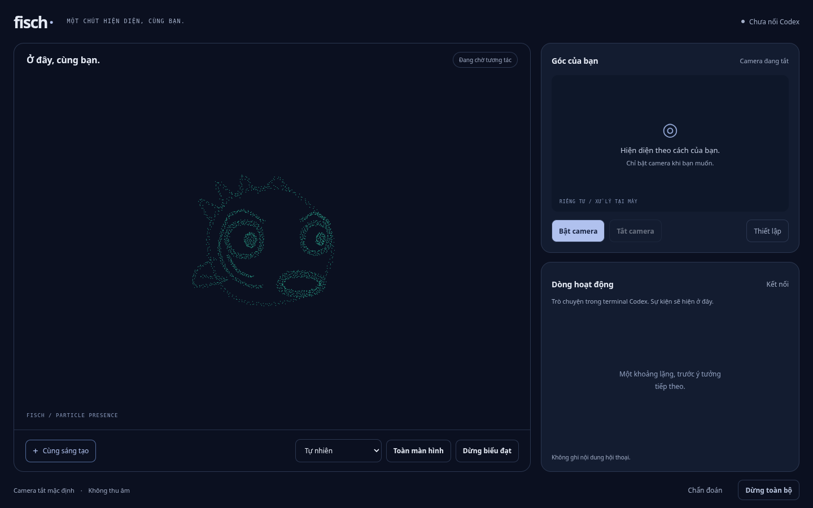

# Fisch

**A particle body that an AI agent can shape for itself.**

Fisch gives an agent a visual way to communicate alongside its words. It can move a face, turn its whole body into an illustration, or add new parts to a scene. The agent authors the geometry, color and motion to fit the context, rather than choosing from a fixed list of expressions.

The goal is a body that responds naturally during conversation and work. The agent keeps its own reasoning, memory and tools; Fisch handles expression and optional local observation.



*Live interface, with camera off and Codex disconnected.*

## Project status

Fisch is an experimental local browser app, currently integrated with Codex. Agent-authored shapes, motion, a same-thread text panel and optional face/hand tracking are implemented. Reliable spontaneous expression and a coherent proactive interaction loop are still being developed and evaluated. See [current scope](docs/expression-capability-experience.md) and [validation](docs/validation.md).

## Quick start

You need **Node.js 22.12+**, **npm**, **Rust stable** with your platform's compiler tools, **Edge/Chrome or Playwright Chromium**, and a **signed-in Codex CLI** with app-server/remote support. See the [setup guide](docs/fisch-live.md#chuẩn-bị-checkout-mới) for compatibility and troubleshooting.

```sh
git clone https://github.com/fishperson113/agent-expression-runtime.git
cd agent-expression-runtime
npm link
fisch live
```

The first launch installs dependencies, builds the app and downloads face-tracking models. Fisch opens in your browser, with Codex in the terminal. Start or select a Codex thread there, then use the browser's text panel or continue in the terminal.

After installation, run `fisch live` from the project you want to work in. From the Fisch checkout, `npm start` also works.

Plain Live prepares proactive Native Codex reactions by default without manual reactive variables or a ledger. Explicit off/backend/budget settings remain respected; configuration-ready is not proof of a successful model response. See [Native launch details](docs/native-observation-loop.md).

Camera starts off. Enable it only when you want local tracking; real camera images stay on your machine. Expression works with camera off. [Live controls and privacy](docs/fisch-live.md) covers optional hand tracking, setup options and stopping a session.

## Documentation

- [Live guide](docs/fisch-live.md): setup, controls and privacy
- [Expression tools](docs/composable-expression.md): agent-authored shapes and motion
- [Architecture](docs/architecture.md): how the runtime fits together
- [Contributing](docs/my-harness.md): development workflow and required checks

## License

[MIT](LICENSE). Third-party components keep their [own licenses](docs/dependency-licenses.md). Contributions are welcome under the [Code of Conduct](docs/CODE_OF_CONDUCT.md).
